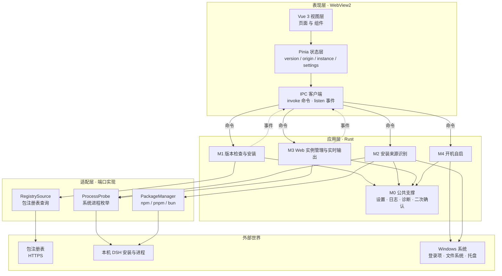
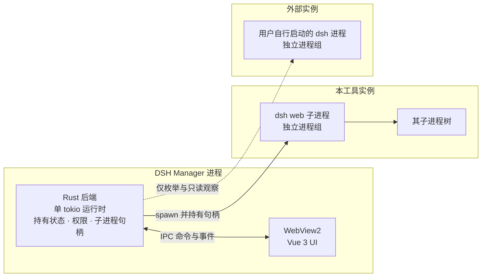
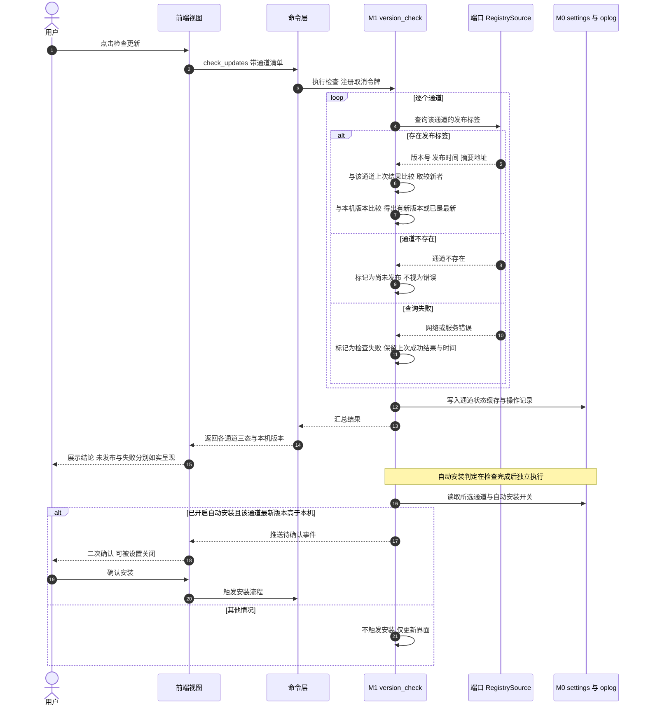
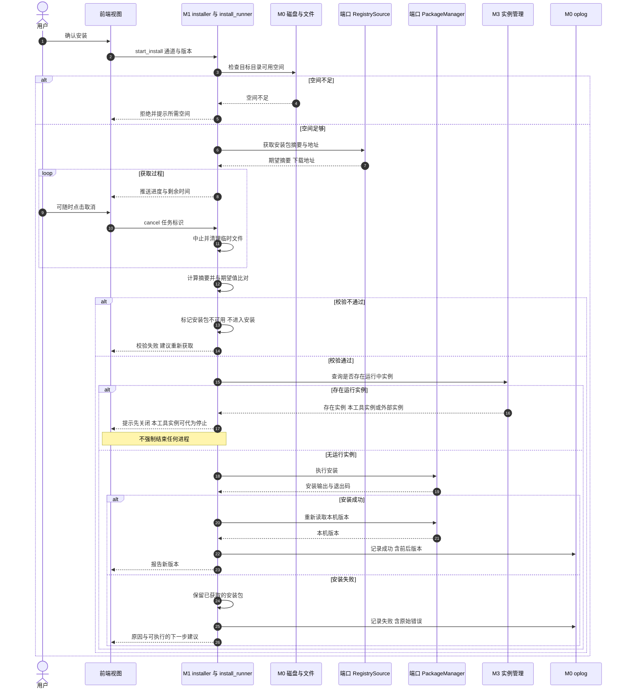
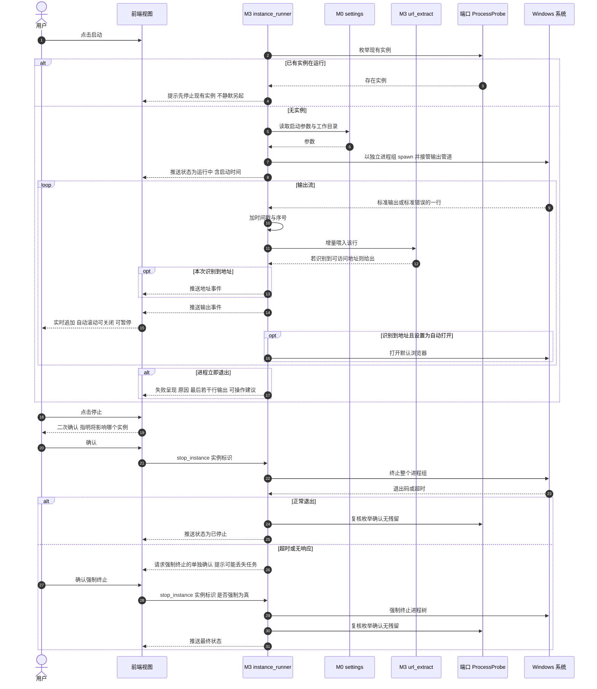
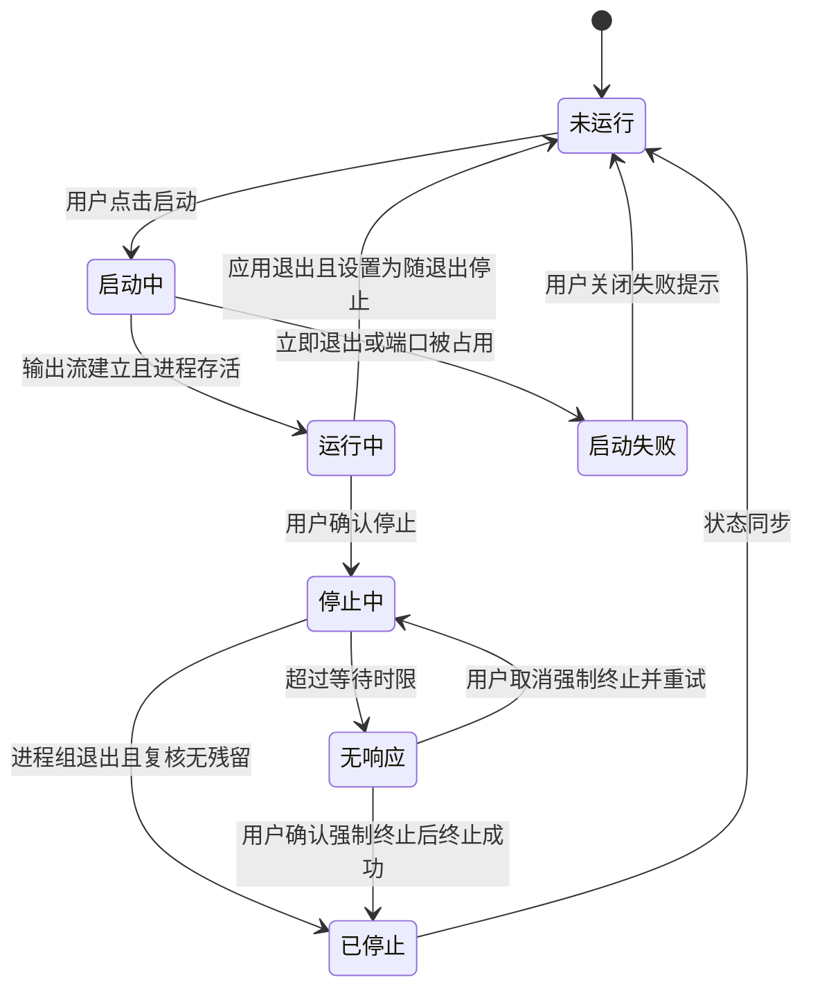

# DSH Manager 软件设计说明书

| 项       | 内容                                     |
| -------- | ---------------------------------------- |
| 文档名称 | DSH Manager 软件设计说明书（SDD）        |
| 版本     | v0.1.4（草案）                           |
| 日期     | 2026-10-16                               |
| 状态     | 待评审                                   |
| 需求基线 | 《DSH Manager 软件规格需求说明书》v0.4   |
| 适用范围 | Windows 10 / Windows 11 桌面             |
| 文档层级 | 概要设计（不含逐函数实现细节与实施计划） |

本文档描述“怎么做”：软件结构、功能模块划分、技术选型与理由、模块间接口、关键流程、数据与错误处理设计。需求条目编号（FR-x / NFR-x）均引自需求基线，**本文档不新增功能需求**；若发现需求缺口，记入 §10。

## 修订记录

| 版本   | 日期       | 修订人 | 修订内容                                                                                                                                                                                                                                                                                                                                                                                                                                                                                             |
| ------ | ---------- | ------ | ---------------------------------------------------------------------------------------------------------------------------------------------------------------------------------------------------------------------------------------------------------------------------------------------------------------------------------------------------------------------------------------------------------------------------------------------------------------------------------------------------- |
| v0.1   | 2026-10-16 | —      | 首次发布。基于 SRS v0.3（已移除第三方插件管理，功能需求重排为 FR-1~FR-5）编制概要设计。                                                                                                                                                                                                                                                                                                                                                                                                              |
| v0.1.1 | 2026-10-16 | —      | 依独立核验意见修订：原则 P2 与 NFR 无副作用条目（v0.4 起编号为 NFR-8）的落点限定为“系统状态”，消除与通道缓存写入的矛盾；时序图命令名与 §6.2 命令表对齐，去除未定义的 force_stop；§1.1 章节引用改为实际章节号；DSH 未安装条目收敛措辞；D-1 对应关系改为 SRS R2。                                                                                                                                                                                                                                      |
| v0.1.2 | 2026-10-16 | —      | 随需求基线 v0.4 同步：新增 FR-1.8（系统代理）与 FR-1.9（版本来源为 `@deepseek-ai/dsh` 单一包）的落点（§3.1、§4.5、§4.6、§8.2、§9.1），M0 增补“网络与代理”子模块与“系统代理”术语；原 NFR-5~NFR-9 引用上移为 NFR-4~NFR-8（该轮遗留 5 处未改，由 v0.1.3 补齐）；代理不可用与代理认证失败、本机 DSH 非 NPM 包安装方式补入降级矩阵；移除设置回滚设计与原 D-7。                                                                                                                                            |
| v0.1.3 | 2026-10-16 | —      | 依独立核验意见修订：补齐 §6.2 两处命令、`oplog:entry` 事件与 §7.3 的 NFR 引用（应由 NFR-6 可诊断承接，原误标 NFR-7），以及原则 P7 的降级引用（应为 NFR-7，原误标 NFR-8）；版本栏更正为 v0.1.2；§1.1 章节索引、§6.3 版本视图范围、§9.1 FR-1.9 行的引用补全（§4.6、§3.1、§8.2）；§4.6 与 §8.2 对「未识别」的措辞拆分为「确定不属于」与「无法确认」两种情形；v0.1.2 行「全量上移」改为如实记载遗留 5 处。版本栏同步为 v0.1.3。                                                                          |
| v0.1.4 | 2026-10-16 | —      | 依评审意见调整前端选型：**引入 Vue Router 4**（原“不引入路由库、顶部标签手动切换”的决定作废），§6.3 改为路由表并约定哈希历史、默认重定向与视图懒加载；**引入图标库 `@lucide/vue`**（原“图标用内联 SVG、不引入图标字体”作废；注意包名为 v1 的 `@lucide/vue`，非旧名 `lucide-vue-next`），明确按需引入以保留 tree-shaking；§4.1 选型总览、§4.2 理由与取舍、§4.3 YAGNI 清单同步更新。核验补充：明确“打开浏览器”等外部跳转使用通用图标而非品牌图标；哈希历史的表述由“唯一”收敛为“最稳妥、无需额外配置”。 |

---

## 1. 绪论

### 1.1 文档定位与章节索引

本文档用于把需求基线固化为可实现的软件结构，其章节定位如下：

| 层级     | 文档定位                                                               |
| -------- | ---------------------------------------------------------------------- |
| 软件结构 | §2：分层、设计原则、依赖方向、运行进程模型                             |
| 功能模块 | §3：模块清单、子模块划分、模块职责边界                                 |
| 技术选型 | §4：选型总览、逐项理由与取舍、Tauri 权限收敛、系统代理、版本来源范围   |
| 详细设计 | §5 关键流程、§6 接口设计（含 §6.3 路由结构）、§7 数据设计、§8 错误处理 |
| 需求追溯 | §9：功能需求、非功能需求、端到端验收场景的覆盖矩阵                     |
| 遗留问题 | §10：设计侧待确认项与建议                                              |

上表的章节号是本文档内部的定位锚点：需求条目与设计条目的对应关系一律以 §9 需求追溯矩阵为准，不以章节归属推断。

### 1.2 需求基线说明

需求基线为 SRS v0.4，功能需求共 5 组：FR-1 版本检查与通道安装、FR-2 安装来源识别、FR-3 启动 DSH Web 并显示输出、FR-4 DSH Web 实例管理、FR-5 开机自启。非功能需求共 8 条（NFR-1~NFR-8）。**第三方插件管理已移出本期范围**，本文档不含其模块设计，代码结构也不为其预留抽象（见 §2.2 原则 P6）。

### 1.3 术语与约定

沿用需求基线 §2 术语。本文档额外使用：

| 术语       | 含义                                                                                                                                   |
| ---------- | -------------------------------------------------------------------------------------------------------------------------------------- |
| 端口       | 本设计中对外部世界（网络、进程、文件、包管理器）的抽象接口，可替换实现                                                                 |
| 适配器     | 端口的一个具体实现，例如“读 Windows 注册表”或“内置测试数据”                                                                            |
| 本工具实例 | 由 DSH Manager 启动并持有子进程句柄的 DSH Web 实例                                                                                     |
| 外部实例   | 非 DSH Manager 启动、由用户或其他程序启动的 DSH Web 实例                                                                               |
| 通道       | 需求基线中的“更新通道”，在数据来源上对应包注册表的一个发布标签                                                                         |
| 系统代理   | 由 Windows（WinINET / WinHTTP）或 `HTTPS_PROXY`、`HTTP_PROXY` 环境变量提供的代理设置；本工具只读沿用，不修改、不读取其中的凭据（§4.5） |

---

## 2. 软件结构

### 2.1 总体结构

应用采用 **Tauri 2 前后端分离 + 端口适配器** 的单体桌面应用结构，共三层：

- **表现层**：Vue 3 单页应用，运行在 Tauri 的 WebView2 中，负责展示与用户交互，不含任何系统访问能力。
- **应用层**：Rust 侧的五个功能模块（M0~M4），承载全部业务逻辑，是唯一有权访问系统的代码。
- **适配层**：三个端口的具体实现，把网络、进程、包管理器的差异收敛在一处。应用数据目录路径由 Tauri 的应用路径接口在装配时确定，日志与输出的落盘直接使用标准文件 API，不再另设文件端口。

表现层与应用层通过 **命令-事件双向通道** 通信：前端用命令发起请求，后端用事件推送进度与实时输出。前端无法直接触碰系统，所有能力必须经后端授权，这是本设计的安全边界。

> 图中 M0 公共支撑被其余四个模块依赖，故未单独画出反向连线；M2 对 Windows 系统的连线表示其读取环境变量与文件系统以取证。

### 2.2 设计原则

| 编号 | 原则                     | 落地方式                                                                                                                                                                     |
| ---- | ------------------------ | ---------------------------------------------------------------------------------------------------------------------------------------------------------------------------- |
| P1   | 外部世界不可信，必须隔离 | 只对 `RegistrySource`、`ProcessProbe`、`PackageManager` 三个接口抽端口，网络与进程相关的失败路径可在无副作用条件下测试                                                       |
| P2   | 只读优先                 | 仅查看的功能（FR-2 全组、FR-4.1、FR-1.1、FR-1.2）不持有任何**系统状态**的写句柄——不写 DSH 安装目录、不写登录项、不写用户文件；本工具自身的通道状态缓存与操作记录除外（§7.2） |
| P3   | 幂等与可取消             | 每个长任务持有一个取消令牌；重复取消、超时取消均安全；取消后不残留半成品状态（NFR-2）                                                                                        |
| P4   | 失败必须可解释           | 所有错误统一为“原因 + 下一步”结构（NFR-1），禁止把失败降级为默认值或“已成功”                                                                                                 |
| P5   | 状态以系统为准           | 开机自启以系统登录项真实状态为准，而非本地配置（FR-5.3）；实例列表以进程枚举结果为准，而非后端内存记录                                                                       |
| P6   | 不为未定需求预留抽象     | 插件管理已移出本期范围，不设计其端口、表结构或空接口。将来若恢复，按新需求重新设计，不预先猜测形态                                                                           |
| P7   | 降级不崩溃               | DSH 未安装、无网络、目录不可读时应用仍可启动并如实提示，不自动“修复”（NFR-7）                                                                                                |

### 2.3 分层与依赖方向

依赖方向自上而下单向，禁止反向依赖与跨层直连：

| 层     | 可依赖             | 禁止依赖                           |
| ------ | ------------------ | ---------------------------------- |
| 表现层 | 应用层的命令       | 适配层、外部系统、文件系统         |
| 应用层 | 端口接口、M0       | 适配层的具体实现（仅由装配点注入） |
| 适配层 | 端口接口、外部系统 | 应用层模块                         |

装配点（`lib.rs` 的启动装配）是唯一同时认识应用层与适配层的位置，负责把具体适配器注入端口。这使测试可以绕过装配点直接注入假实现。

### 2.4 运行进程模型

三条必须守住的行为边界：

1. **本工具实例**由本工具 spawn，持有进程句柄与输出管道，可实时读取输出，可完整停止。同一时间至多一个（FR-4.2）。
2. **外部实例**只被枚举与观察，不持有句柄。可显示进程信息与端口，**无法**获取其输出（FR-3.2 的实时输出不适用于外部实例，界面须明确标注）；仅在用户于更强确认下明确要求时才停止（FR-4.3）。
3. **停止的完整性**：停止针对进程组而非单个进程，避免 DSH 派生的子进程残留（FR-3.4、E2E-7）。应用自身退出时按设置处理本工具实例，外部实例在任何情况下都不自动终止（FR-4.4）。

---

## 3. 功能模块划分

### 3.1 模块清单

| 模块 | 名称                   | 对应需求              | 优先级 | 说明                                                                                           |
| ---- | ---------------------- | --------------------- | ------ | ---------------------------------------------------------------------------------------------- |
| M0   | 公共支撑               | NFR-1~NFR-8、FR-1.8   | P0     | 设置存取、操作记录、日志与诊断导出、取消令牌、二次确认、网络与代理、统一错误                   |
| M1   | 版本检查与通道安装     | FR-1.1~FR-1.7、FR-1.9 | P0     | 通道三态、版本比较、自动安装策略、安装包获取与安装执行；版本源固定为 `@deepseek-ai/dsh` 单一包 |
| M2   | 安装来源识别           | FR-2.1~FR-2.5         | P0     | 多来源取证、判定、依据展示、未识别如实输出                                                     |
| M3   | Web 实例管理与实时输出 | FR-3、FR-4            | P0     | 实例发现、启动、输出流、地址识别、停止、状态与失败呈现                                         |
| M4   | 开机自启               | FR-5.1~FR-5.5         | P0     | 开关、启动行为、与系统状态一致、关闭即清理                                                     |

M0 的网络与代理职责只有两条：让出网请求走系统代理，以及在代理失败时给出可读原因。它不管理代理地址、不缓存凭据、不提供代理配置界面（见 §4.5）。

**FR-1.9 的落点**：版本管理的对象在本设计中固定为 NPM 包 `@deepseek-ai/dsh` 一个包——适配层的通道清单映射该包的发布标签（D-1），本机版本取自该包的安装版本，不存在第二版本源。界面在展示版本号处标注其属于该包，避免与 DSH 自身可能存在的运行时组件版本混淆。

### 3.2 子模块划分

| 子模块               | 归属 | 单一职责                                                             |
| -------------------- | ---- | -------------------------------------------------------------------- |
| `settings`           | M0   | 读写应用设置，提供默认值与校验，变更即时持久化                       |
| `oplog`              | M0   | 记录操作时间、动作、结果；失败保留可复制错误信息                     |
| `logging`            | M0   | 运行输出与操作记录落盘、按大小滚动、上限可配置                       |
| `diagnostics`        | M0   | 汇总运行环境与最近操作，导出可读诊断包（不含凭据）                   |
| `cancel`             | M0   | 长任务取消令牌的注册、触发与清理                                     |
| `network`            | M0   | 出网请求的唯一出口，沿用系统代理设置，代理凭据不读取、代理配置不修改 |
| `version_check`      | M1   | 三态通道状态、版本比较结论、上次成功结果缓存                         |
| `installer`          | M1   | 安装包获取、进度与剩余时间、完整性校验、取消与重试                   |
| `install_runner`     | M1   | 安装前运行检测、安装执行、安装后版本复核                             |
| `origin_detect`      | M2   | 取证与判定，输出唯一结论与依据清单                                   |
| `instance_discovery` | M3   | 枚举 Web 形态实例，产出运行时长与地址                                |
| `instance_runner`    | M3   | 本工具实例的启动、输出流、停止与残余清理                             |
| `url_extract`        | M3   | 从输出流增量识别可访问地址                                           |
| `autostart`          | M4   | 登录项读写、启动行为参数、与系统状态一致性校验                       |

### 3.3 模块职责边界

| 模块 | 负责                     | 明确不负责                                           |
| ---- | ------------------------ | ---------------------------------------------------- |
| M0   | 跨模块的基础设施与一致性 | 任何业务判定（版本高低、来源结论、实例状态）         |
| M1   | 版本事实与安装动作       | 停止实例的动作本身（调用 M3 的停止能力，不自行实现） |
| M2   | 给出结论与依据           | 修改任何本机状态（FR-2.4，只读路径）                 |
| M3   | 实例生命周期与输出       | 判定版本新旧、读写登录项                             |
| M4   | 本应用自身的登录项       | 启动 DSH、修改 DSH 的任何设置（FR-5.1）              |

---

## 4. 技术选型

### 4.1 选型总览

| 领域        | 选型                                  | 版本基线  | 定/待定 |
| ----------- | ------------------------------------- | --------- | ------- |
| 应用框架    | Tauri 2                               | 2.x       | 已定    |
| 前端框架    | Vue 3 组合式 API + TypeScript         | 3.5+      | 已定    |
| 前端构建    | Vite                                  | 7.x       | 已定    |
| 样式与组件  | Tailwind CSS 4 + DaisyUI 5            | 4.x / 5.x | 已定    |
| 前端状态    | Pinia                                 | 3.x       | 已定    |
| 前端路由    | Vue Router                            | 4.x       | 已定    |
| 图标        | `@lucide/vue`（按需引入）             | 1.x       | 已定    |
| 后端语言    | Rust（stable，最低 1.90）             | 1.90+     | 已定    |
| 异步运行时  | tokio（经 Tauri 运行时）              | 1.x       | 已定    |
| HTTP 客户端 | reqwest + rustls                      | 0.12+     | 已定    |
| 版本比较    | 官方 `semver` crate                   | 1.x       | 已定    |
| 进程枚举    | `sysinfo`                             | 0.33+     | 已定    |
| 进程树终止  | 系统 `taskkill` 命令（/T 树终止）     | 系统自带  | 已定    |
| 摘要校验    | `sha2`                                | 0.10+     | 已定    |
| 登录项      | `tauri-plugin-autostart`              | v2 兼容   | 已定    |
| 系统对话框  | `tauri-plugin-dialog`                 | v2 兼容   | 已定    |
| 打开链接    | `tauri-plugin-opener`                 | v2 兼容   | 已定    |
| 应用日志    | `tauri-plugin-log` + 自建滚动策略     | v2 兼容   | 已定    |
| 本地存储    | JSON 文件（设置、通道缓存、操作记录） | —         | 已定    |

### 4.2 关键选型理由与取舍

**Tauri 2（已定）**。选择它的实质理由是**进程与系统访问都在 Rust 侧**：本应用的核心能力是启动并监管子进程、枚举系统进程、读写登录项、查询包管理器，这些能力若放在 Electron 的 Node 主进程里需要额外的原生模块；Tauri 直接把这些交给 Rust 标准库与系统 API。附带收益是安装体积与空闲内存显著低于 Electron 方案，符合 NFR-5。代价是 Rust 侧开发成本高于 Node，且 WebView2 依赖系统组件（Windows 10/11 已内置，不构成本项目的额外依赖）。

**Vue 3 + Pinia（已定）**。界面状态天然分成四块（版本、来源、实例、设置），与功能模块一一对应；Pinia 提供跨视图共享与类型推导，不需要额外的状态库。

**Vue Router 4（已定）**。视图导航改用路由而非手动切换，收益有三点：一是**视图与 URL 一一对应**，点击访问地址、排查问题、重载页面都能落回同一视图；二是导航状态（当前视图、返回栈）由路由统一持有，不必在组件里维护"当前选中哪个标签"这类派生状态；三是视图按路由懒加载，四个视图的代码可分包，首屏只加载当前视图。约束：本期只使用**哈希历史**（`createWebHashHistory`）——桌面应用的页面由自定义协议加载，无服务端可处理路径回退，哈希模式是**最稳妥、无需额外配置**的选择（`createWebHistory` 配合开发与打包两侧的路径回退亦可工作，但需额外配置，本期不采用）；不引入嵌套路由、路由守卫与过渡动画。

**图标 `@lucide/vue`（已定）**。四个视图的导航与状态标识需要一组语义一致的图标，自绘内联 SVG 要逐个手写路径且风格难以统一。选择它的理由：为 Vue 3 原生封装，每个图标是一个独立组件，按需引入即可被构建期 tree-shaking 掉（包声明 `sideEffects: false`，构建器可安全摇树），不会把整个图标集打进产物；无运行时网络请求，离线可用；纯 SVG 组件而非图标字体，无字体加载闪烁、无字体子集化配置。约束两条：一是**按需引入单个图标组件**（`import { Play } from '@lucide/vue'`），不使用"注册全部图标"的写法，否则失去 tree-shaking 收益；二是**包名必须是 `@lucide/vue`**——Lucide v1 起 Vue 包已由 `lucide-vue-next` 迁移至此名（API 不变），沿用旧名会装到 v0 线；v1 同时移除了品牌图标（GitHub、Slack、Chromium 等），本应用只需通用图标，**“打开浏览器”等外部跳转一律使用通用图标（如 `ExternalLink`），不使用浏览器品牌图标**——这是本应用最容易误用品牌图标的位置，写成品牌图标会直接构建失败。

**Tailwind CSS 4 + DaisyUI 5（已定）**。本应用界面是同构的“卡片 + 表格 + 徽章 + 进度条 + 对话框 + 实时日志”，DaisyUI 5 直接提供这些语义化组件类与内置主题，省掉自建组件库。约束：DaisyUI 5 要求 Tailwind CSS 4，两者需同版本族引入；引入方式为确定性安装，不使用 CDN（桌面应用需离线可用，且 CDN 与 NFR-3「不上传任何本机数据」的精神冲突）。

**reqwest + rustls（已定）**。满足 FR-1.5「传输过程须加密」。选 rustls 而非系统原生 TLS，是为了避免依赖系统 TLS 配置，行为更可预测，也免去 OpenSSL 类动态库的部署负担。**与 FR-1.8 的关系**：reqwest 在 Windows 上默认启用系统代理支持（由 `hyper-util` 读取 WinHTTP/WinINET 配置并识别 `HTTPS_PROXY`、`HTTP_PROXY` 环境变量），因此系统代理是**既有依赖的默认行为，不是需要自己实现的代码**。本设计需要做的只有两件事：确认该行为未被关闭（不显式设置 `no_proxy()`），以及在代理认证失败时给出可读的失败原因——见 §4.5。

**官方 `semver` crate（已定）**。FR-1.3 的验收要求（`0.2.0-rc.2 > 0.2.0-rc.1`、`0.2.0 > 0.2.0-rc.2`）正是语义化版本 2.0.0 规范关于预发布版本优先级的条款。**自己写比较逻辑是明确要避免的**：该规范在“预发布标识逐段比较”“数字段与字母段不可混比”“预发布版本低于同版本正式版”几处细节上极易写错，而写错的后果正是需求基线点名的漏报或误报更新。选择成熟实现把这类风险移出本项目。

**`sysinfo`（已定）**。FR-4.1 需要“启动时间”与“运行时长”，这要求读到进程创建时间。`sysinfo` 跨版本稳定提供进程创建时间与命令行，避免直接手写 Toolhelp32 快照遍历。若后续发现其对某些受保护进程读取失败，该能力被封装在 `ProcessProbe` 端口之后，替换实现不影响调用方。

**`taskkill` 而非手写终止（已定）**。FR-3.4 与 E2E-7 要求“不留残余进程”。Windows 上终止整棵进程树的正确做法是 `taskkill /PID <pid> /T`，自建“递归枚举子进程再逐个终止”存在竞态。这是**用系统原生能力替代自研代码**的取舍：少写代码，且行为与系统一致。

**不引入的依赖（YAGNI）**：

| 候选                        | 不引入的理由                                                                    |
| --------------------------- | ------------------------------------------------------------------------------- |
| Element Plus / Naive UI     | 与 DaisyUI 5 职责重复；且本应用界面为同构卡片式，不需要重型组件库               |
| axios / ofetch              | 前端不直接发起网络请求，全部 HTTP 在 Rust 侧，前端无此需求                      |
| dayjs / date-fns            | 时间格式化需求限于“时间戳 / 时长 / 日期”三种，原生 `Intl` 与 `Date` 足够        |
| 任何 Node.js sidecar        | 后端为纯 Rust，不引入 Node 运行时，避免体积与启动时间代价（见 §4.3）            |
| 图标字体（Font Awesome 等） | 需字体文件与子集化配置，且有加载闪烁；矢量图标组件（`@lucide/vue`）无此问题     |
| 组件级动画库                | 本期无转场需求，DaisyUI 自带的过渡类足够                                        |
| 数据库（SQLite 等）         | 数据结构为少量配置与追加式日志，JSON + 滚动文本文件足够；引入数据库属于过度设计 |

### 4.3 后端不引入 Node.js sidecar 的理由

插件与版本相关逻辑确实存在于 DSH 的 JavaScript 生态中，理论上复用它可以少写代码。但那意味着把 Node 运行时打进安装包，安装体积与冷启动时间明显变差，且与 NFR-5「空闲时资源占用可忽略」冲突。本设计的选择是：**只调用外部命令，不嵌入运行时**。包管理器（npm/pnpm/bun）与 DSH 自身 CLI 均以子进程方式调用，属于“使用用户机器上已有的工具”，不增加分发体积。

### 4.4 Tauri 权限收敛

Tauri 2 的权限模型下，前端默认无权访问任何系统能力。本项目只授予必要权限，并在评审时逐条核对：

| 能力          | 授予情况   | 用途                                               |
| ------------- | ---------- | -------------------------------------------------- |
| 自定义命令    | 全部授予   | 五组业务命令，前端能力的主要来源                   |
| `dialog`      | 部分       | 文件保存对话框（日志另存为）、确认弹窗             |
| `opener`      | 受限       | 打开访问地址所在浏览器                             |
| `autostart`   | 授予       | 登录项开关（FR-5）                                 |
| `fs` / `http` | **不授予** | 文件与网络访问全部在 Rust 侧完成，前端不得直接访问 |
| `shell`       | **不授予** | 前端不得直接执行任何外部命令                       |

「前端不得直接执行命令、不得直接访问网络与文件」是本设计的硬边界：它同时满足 NFR-3（不上传本机数据）与 NFR-8（只读功能无副作用），因为所有系统访问都经后端模块，而模块的写路径是可枚举、可审计的。

系统代理的读取同样适用该边界：前端不参与代理配置，由 M0 `network` 在后端统一处理，且只读不写（FR-1.8）。

### 4.5 系统代理

FR-1.8 要求访问外网时沿用用户已有的系统代理，且不读取代理凭据、不修改代理配置。设计落点如下：

| 方面         | 设计                                                                                                                    |
| ------------ | ----------------------------------------------------------------------------------------------------------------------- |
| 代理来源     | 复用 HTTP 客户端依赖的系统代理支持：Windows 上读取 WinHTTP/WinINET 配置，同时识别 `HTTPS_PROXY`、`HTTP_PROXY` 环境变量  |
| 需要写的代码 | **无**。不显式关闭代理支持即为满足；本设计不新增代理配置界面、不自建代理解析                                            |
| 凭据边界     | 仅读取代理地址与端口；不读取、不显示、不保存系统已保存的代理凭据（NFR-3）                                               |
| 认证失败处理 | 识别为独立的失败类型，如实说明“代理需要认证”并给出用户在系统侧预先授权的建议，不重试、不降级为网络不可达（NFR-7、§8.2） |
| 只读保证     | 不修改注册表代理项、不写环境变量；代理变更由用户在系统侧自行完成                                                        |

取舍说明：**不做应用内代理配置**。需求只要求“沿用系统代理”，自建代理设置界面会让用户面对两套互相覆盖的代理配置（与 R1 同类的困惑），且增加设置项与持久化成本。若将来确认需要按应用单独指定代理，再在设置中增加覆盖项。

### 4.6 版本来源范围

FR-1.9 把版本源收敛为单个 NPM 包 `@deepseek-ai/dsh`。对设计的影响是**减少**而非增加：通道清单映射到该包的发布标签，本机版本读取该包的安装版本，`RegistrySource` 与 `PackageManager` 两个端口都只服务这一个包，无需为多版本源设计合并规则。界面在版本号处标注包名，使“本工具管理的版本”与“DSH 自身可能存在的运行时组件版本”不混淆。

**与 FR-2 的衔接**：来源识别的结论会反过来决定版本管理是否可用。M2 判定为「包管理器安装」时，版本比较按常规进行；判定为「官方安装器安装」「便携版」时，本机版本确定不属于该 NPM 包，M1 须**不产出**版本对比结论；判定为「未识别」时归属无法确认，同样不产出对比结论。两种情况均由界面如实说明本工具的版本管理对该安装方式不适用或无法确认，并指向来源识别页，不得猜测版本（FR-2.3）。该分支的降级行为见 §8.2。

---

## 5. 关键流程设计

### 5.1 版本检查与自动安装

三态（已发布 / 尚未发布 / 检查失败）是本流程的核心。**“尚未发布”不是错误**：注册表中不存在该发布标签时，结果为“尚未发布”，界面如实展示且不记录为故障。**“检查失败”不覆盖上次结果**：失败时保留上次成功的时间与数据，界面同时展示两者，这直接对应 E2E-2。

要点：

- 通道清单与发布标签的映射关系在适配层维护，判定逻辑只处理“存在 / 不存在 / 查询失败”三种输入。
- 只有一个通道可处于自动安装态（FR-1.4）；通道切换请求先经二次确认，确认后才改写设置。
- 是否“高于本机版本”一律经版本比较端口得出，不比较字符串（FR-1.3）。

### 5.2 安装包获取与安装执行

要点：

- **校验先于安装**：摘要不匹配时安装包被标记为不可用，绝不进入安装步骤（FR-1.5）。
- **运行检测先于安装**：检测到实例时只提示，不代为结束进程；本工具实例可由用户选择经 M3 停止（FR-1.6）。
- **失败保留安装包**：失败路径不删除已校验通过的安装包，便于用户手工安装（FR-1.6）。
- **取消不留残**：取消时清理临时文件与令牌，界面回到可重试状态（NFR-2）。

### 5.3 启动与停止 Web 实例

要点：

- **输出必须流式推送**，不缓冲到结束（FR-3.2）。时间戳与序号在后端生成，保证顺序稳定；前端暂停只影响渲染，不影响接收。
- **地址识别是增量的**：逐行喂入，跨行拼接的处理放在提取器内部；同一地址只上报一次。
- **停止后必须复核**：终止调用返回不代表进程已消失，需再次枚举确认（E2E-7「无残留」）。
- **外部实例的停止走更强确认**：界面必须明确区分实例归属（FR-4.3）。

### 5.4 实例状态判定

状态来源的优先级：**系统实际状态高于后端记录**。后端在每次推送前以进程枚举结果校正自身记录，避免出现“界面显示运行中而进程已退出”的残留状态（FR-4.1、FR-5.3 的一致性原则）。

---

## 6. 接口设计

### 6.1 端口接口

三个端口是全部外部依赖的边界。接口以最小必要面定义，每个方法都必须能被一个假实现替换，否则不得放入端口。

| 端口             | 方法（语义）                                                                                  | 主要适配器                                  | 服务的需求                     |
| ---------------- | --------------------------------------------------------------------------------------------- | ------------------------------------------- | ------------------------------ |
| `RegistrySource` | 列出通道 → 查询通道的发布标签 → 取版本号、发布时间、摘要、下载地址 → 下载到指定路径并回报进度 | 真实 HTTPS 适配器、测试用固定响应适配器     | FR-1.1~FR-1.5                  |
| `ProcessProbe`   | 枚举进程 → 取命令行与创建时间 → 按命令行特征匹配 DSH Web 实例 → 复核某进程是否存活            | 基于 `sysinfo` 的适配器、测试用进程表适配器 | FR-3.5、FR-4.1、FR-4.3、FR-4.5 |
| `PackageManager` | 报告自身可用性 → 报告全局模块根目录 → 报告已安装版本 → 执行安装 → 重新读取版本                | npm / pnpm / bun 三个适配器、测试用假适配器 | FR-1.6、FR-2                   |

三个端口的实现选择（哪个包管理器命中、用哪个工具探测进程）由装配点决定，调用方只依赖接口。

### 6.2 命令与事件

前端只通过以下两组通道与后端交互。命令为请求-响应，事件为后端主动推送。

**命令（前端调用后端）**

| 命令                  | 入参               | 出参                               | 对应需求                       |
| --------------------- | ------------------ | ---------------------------------- | ------------------------------ |
| `check_updates`       | 通道清单           | 各通道三态、本机版本、上次成功时间 | FR-1.1、FR-1.2                 |
| `set_auto_channel`    | 通道标识、是否开启 | 生效后的设置                       | FR-1.4                         |
| `start_install`       | 通道、目标版本     | 任务标识                           | FR-1.5、FR-1.6                 |
| `cancel_task`         | 任务标识           | 是否已受理                         | NFR-2                          |
| `detect_origin`       | 无                 | 唯一结论、依据清单、缺失项         | FR-2.1~FR-2.5                  |
| `list_instances`      | 无                 | 实例列表或空列表                   | FR-4.1                         |
| `start_instance`      | 启动参数、工作目录 | 本工具实例标识                     | FR-3.1、FR-4.2                 |
| `stop_instance`       | 实例标识、是否强制 | 停止结果与复核结果                 | FR-3.4、FR-4.3、FR-4.5         |
| `list_output`         | 实例标识、起始序号 | 输出缓冲片段                       | FR-3.2、FR-3.5                 |
| `export_output`       | 实例标识、目标路径 | 写入结果                           | FR-3.2                         |
| `get_settings`        | 无                 | 全部设置                           | FR-1.4、FR-3.3、FR-4.4、FR-5.2 |
| `update_settings`     | 变更项             | 生效后的设置                       | 同上                           |
| `get_autostart_state` | 无                 | 系统真实状态、登录项详情           | FR-5.3                         |
| `set_autostart`       | 是否开启、启动行为 | 生效后的系统状态                   | FR-5.1、FR-5.2、FR-5.4         |
| `export_diagnostics`  | 目标路径           | 写入结果                           | NFR-6                          |
| `list_oplog`          | 分页参数           | 操作记录页                         | NFR-6                          |

**事件（后端推送前端）**

| 事件               | 载荷                                         | 对应需求       |
| ------------------ | -------------------------------------------- | -------------- |
| `task:progress`    | 任务标识、百分比、剩余时间、阶段             | FR-1.5         |
| `instance:state`   | 实例标识、状态、启动时间、运行时长           | FR-3.5、FR-4.1 |
| `instance:output`  | 实例标识、序号、时间戳、原始文本、是否错误流 | FR-3.2         |
| `instance:url`     | 实例标识、识别到的可访问地址                 | FR-3.3         |
| `update:available` | 通道、版本、是否需用户确认                   | FR-1.4         |
| `oplog:entry`      | 新产生的操作记录                             | FR-1.6、NFR-6  |

事件名采用“域:动作”命名，避免与命令名混淆。前端在视图挂载时统一注册监听，在卸载时统一注销，防止重复订阅导致输出重复渲染。

### 6.3 前端结构

视图与功能模块一一对应，四个视图平级，各占一个顶级路由：

| 路由路径    | 路由名     | 视图       | 承载需求           | 主要状态来源    |
| ----------- | ---------- | ---------- | ------------------ | --------------- |
| `/version`  | `version`  | 版本与更新 | FR-1.1~FR-1.9      | `version` 状态  |
| `/origin`   | `origin`   | 安装来源   | FR-2.1~FR-2.5      | `origin` 状态   |
| `/instance` | `instance` | 运行实例   | FR-3、FR-4         | `instance` 状态 |
| `/settings` | `settings` | 设置       | FR-5、NFR-5、NFR-6 | `settings` 状态 |

路由约定：

- **默认重定向** `/` → `/version`；未匹配路径回落到 `/version`，不做 404 页（本应用无用户可输入的地址）。
- **历史模式用 `createWebHashHistory`**：桌面应用页面由自定义协议加载，无服务端处理路径回退，哈希模式无需额外配置即稳定。
- **视图懒加载**：四个视图用动态导入，各自分包；首屏只加载当前视图。
- **导航栏与路由同源**：顶部导航项由路由表生成（路径、标题、图标），不单独维护一份标签清单，避免两处不一致。
- 不引入路由守卫、嵌套路由与转场动画：本期无权限分级、无子页面、无转场需求。

四个 Pinia 状态与后端模块同构：这样前端不存在“不知道该找哪个状态”的模糊地带，也避免一个巨型 store 演变成隐性耦合点。

---

## 7. 数据设计

### 7.1 目录布局

数据落在三个位置，职责分离：应用数据（可清理）、缓存（可重建）、临时文件（可随时删除）。三者都在用户目录下，不需要管理员权限。

| 目录                                | 内容                         | 可清理性                         |
| ----------------------------------- | ---------------------------- | -------------------------------- |
| `%APPDATA%\dsh-manager\`            | 设置、操作记录、运行输出日志 | 删除后回到默认设置               |
| `%LOCALAPPDATA%\dsh-manager\cache\` | 通道状态缓存                 | 可随时删除，重建即可             |
| `%LOCALAPPDATA%\Temp\dsh-manager\`  | 已获取的安装包               | 可随时删除；失败时保留供手工安装 |

### 7.2 数据实体

| 实体     | 字段                                                                                                                     | 持久化位置              | 说明                                     |
| -------- | ------------------------------------------------------------------------------------------------------------------------ | ----------------------- | ---------------------------------------- |
| 设置     | 所选通道、自动安装开关、安装前确认开关、启动参数、工作目录、自动打开浏览器、自动滚动、日志上限与保留份数、退出时停止实例 | `settings.json`         | 全部有默认值；解析失败时回落默认值并记录 |
| 通道状态 | 通道标识、三态、版本号、发布时间、摘要地址、上次成功时间、上次失败原因                                                   | `cache/channels.json`   | 失败时保留上次成功内容，不覆盖           |
| 操作记录 | 时间、动作、目标、结果、错误码、原始错误文本                                                                             | `oplog.jsonl`           | 追加式，按大小滚动                       |
| 运行输出 | 实例标识、序号、时间戳、文本、是否错误流                                                                                 | 内存环形缓冲 + 日志文件 | 内存有上限，落盘按大小滚动               |
| 实例记录 | 实例标识、归属、进程标识、启动时间、地址、状态                                                                           | 内存                    | 单一事实来源是进程枚举，此记录为派生视图 |

**设置的可追溯**：每次设置变更写一条操作记录（旧值 → 新值，操作记录见 NFR-6），使设置变更可被用户回溯。设置项另有出厂默认值，解析失败时回落默认值（见上表“设置”行）。需求基线未要求设置的历史版本回退，故本期**不引入**设置版本历史或多套配置快照。

设计取舍：

- **不引入数据库**。数据量上限由 NFR-5 明确限制，JSON 与追加式文本足以支撑，且便于用户直接查看与反馈问题时附带（NFR-6）。引入 SQLite 属于为不存在的数据规模付成本。
- **操作记录用 JSONL**。追加写入不重写整个文件，崩溃时最多丢失最后一行；相比单个 JSON 数组，避免了“写入中断导致整个文件不可解析”的失败模式。
- **运行输出双写**：内存环形缓冲保证界面滚动流畅，日志文件保证可导出与事后诊断。内存上限与文件上限都可配置（NFR-5）。

### 7.3 运行日志与操作记录的区别

两者常被混为一谈，本设计明确区分：

| 维度     | 运行输出                       | 操作记录                             |
| -------- | ------------------------------ | ------------------------------------ |
| 内容     | DSH 实例产生的原始文本         | 本工具执行过的动作及其结果           |
| 来源     | 子进程输出管道                 | 各模块的成功与失败路径               |
| 用途     | 用户观察启动过程、排查启动失败 | 用户回溯自己做过什么、反馈问题时附上 |
| 对应需求 | FR-3.2、FR-3.6                 | NFR-6、FR-1.6                        |

内存与磁盘的占用上限由 NFR-5 约束，以设置项暴露，默认值在评审时确定。

---

## 8. 错误处理设计

### 8.1 统一错误结构

所有对外错误统一为“原因 + 下一步”（NFR-1），在命令返回值与事件载荷中使用同一结构：

| 字段       | 含义                                                       |
| ---------- | ---------------------------------------------------------- |
| 错误码     | 稳定的机器可读标识，界面据此选择呈现方式，前端可做分支判断 |
| 原因       | 面向用户的中文说明，说清“发生了什么”                       |
| 下一步     | 面向用户的中文建议，说清“可以做什么”                       |
| 原始错误   | 底层返回的原文，供复制反馈，不吞错、不改写（FR-1.6 精神）  |
| 是否可重试 | 布尔值，决定界面是否给出重试入口                           |

**禁止事项**：把失败转成默认值；把失败记为成功；用“操作失败”这类无信息的文案替代具体原因。

### 8.2 降级矩阵

NFR-7 要求应用在异常环境下仍可启动并给出明确提示。降级策略逐条对应故障场景：

| 场景                       | 行为                                                                                                                                                     | 对应需求       |
| -------------------------- | -------------------------------------------------------------------------------------------------------------------------------------------------------- | -------------- |
| 无网络                     | 检查更新标记为检查失败，保留上次成功结果与时间，不崩溃                                                                                                   | FR-1.1、E2E-2  |
| 通道尚未发布               | 展示为“未发布”，不计为错误，不告警                                                                                                                       | FR-1.1、R2     |
| DSH 未安装                 | 版本与实例区域如实提示未检测到本机 DSH，并说明缺少哪些依赖、为何不可用；不自动安装、不自动“修复”                                                         | NFR-7          |
| DSH 安装目录不可读         | 如实提示权限问题与所需操作，不降级为“已成功”                                                                                                             | R4             |
| 某依据来源不可用           | 来源识别跳过该项，依据清单标注缺失项，结论仍可给出或为未识别                                                                                             | FR-2.3、FR-2.5 |
| 磁盘空间不足               | 在获取前拒绝并提示所需空间，不开始下载                                                                                                                   | FR-1.5         |
| 安装包校验不通过           | 标记不可用、不进入安装，保留失败原因                                                                                                                     | FR-1.5         |
| 停止实例超时               | 提示无响应，强制终止需单独二次确认                                                                                                                       | FR-4.5         |
| 代理不可用或认证失败       | 如实说明是代理问题而非网络中断；认证失败给出在系统侧预先授权的建议，不重试、不降级                                                                       | FR-1.8、NFR-7  |
| 本机 DSH 非 NPM 包安装方式 | 来源识别结论为官方安装器安装或便携版时，不产出本机版本与版本对比结论；结论为未识别时同样不产出，并说明归属无法确认。两种情况均如实说明并指向来源识别依据 | FR-1.9、FR-2.3 |
| 设置文件损坏               | 回落默认值，记录一条操作记录，不阻止启动                                                                                                                 | NFR-7          |
| 系统状态与本地不一致       | 以系统真实状态刷新界面                                                                                                                                   | FR-5.3         |

### 8.3 危险操作的二次确认

需求基线点名的若干危险操作，确认强度按风险分级，避免把所有操作都做成同样的弹窗而让用户麻木：

| 操作               | 确认强度                                               |
| ------------------ | ------------------------------------------------------ |
| 停止本工具实例     | 普通二次确认，指明实例                                 |
| 停止外部实例       | 强化确认，显式说明该实例非本工具启动、可能正在执行任务 |
| 强制终止无响应实例 | 单独二次确认，提示可能丢失正在进行的任务               |
| 安装新版本         | 普通二次确认，可被用户在设置中关闭（FR-1.4）           |
| 切换自动安装通道   | 普通二次确认（同一时间仅允许一个通道，FR-1.4）         |
| 卸载类操作         | 本期无此类操作（插件管理已移出范围）                   |

---

## 9. 需求追溯

### 9.1 功能需求覆盖

| 需求编号                     | 实现模块                    | 关键设计点                                                                                                                           |
| ---------------------------- | --------------------------- | ------------------------------------------------------------------------------------------------------------------------------------ |
| FR-1.1 通道状态识别          | M1 `version_check`          | 三态判定，未发布不计错误，失败保留上次成功结果                                                                                       |
| FR-1.2 版本信息展示          | M1 `version_check`          | 与本机版本比较后给出明确结论                                                                                                         |
| FR-1.3 版本顺序判断          | M1 + 版本比较依赖           | 使用语义化版本规范实现，覆盖预发布与正式版关系                                                                                       |
| FR-1.4 通道选择与自动安装    | M1 + M0 `settings`          | 单通道约束、切换需确认、结果持久化、触发前二次确认可关闭                                                                             |
| FR-1.5 安装包获取            | M1 `installer`              | 进度与剩余时间、可取消、下载前查空间、摘要校验、HTTPS                                                                                |
| FR-1.6 安装执行              | M1 `install_runner`         | 安装前运行检测、只提示不强杀、失败保留安装包并给建议                                                                                 |
| FR-1.7 与 DSH 自身更新的关系 | M1 + 界面提示               | 界面明确提示可能互相覆盖，本工具不修改 DSH 更新设置                                                                                  |
| FR-1.8 系统代理              | M0 `network` + 客户端依赖   | 沿用系统代理（WinHTTP/WinINET 与环境变量），不新增代码；凭据不读取、配置不修改；认证失败独立呈现（§4.5、§8.2）                       |
| FR-1.9 版本来源范围          | M1 + M2 + 通道映射（D-1）   | 版本源固定为 `@deepseek-ai/dsh` 单一包，无第二版本源合并逻辑；界面标注版本所属包（§4.6、§3.1）；非该包安装方式如实说明不适用（§8.2） |
| FR-2.1 结论输出              | M2 `origin_detect`          | 四值枚举的唯一结论                                                                                                                   |
| FR-2.2 判定依据              | M2                          | 依据清单含“看到了什么、在哪里看到”，可展开                                                                                           |
| FR-2.3 不得猜测              | M2                          | 依据不足输出未识别并说明缺失项                                                                                                       |
| FR-2.4 无副作用              | M2（只读路径）              | 识别路径不持有系统状态的写句柄（操作记录除外）                                                                                       |
| FR-2.5 及时性                | M2 + `ProcessProbe`         | 单项失败跳过，整体有超时，不阻塞界面                                                                                                 |
| FR-3.1 启动                  | M3 `instance_runner`        | 可附加启动参数与选择工作目录                                                                                                         |
| FR-3.2 实时输出              | M3 + 事件 `instance:output` | 流式推送、时间戳与序号、自动滚动、暂停、清空、复制、另存                                                                             |
| FR-3.3 访问地址              | M3 `url_extract`            | 增量识别，可点击，是否自动打开为设置项                                                                                               |
| FR-3.4 停止                  | M3 `instance_runner`        | 进程组终止 + 停止后复核                                                                                                              |
| FR-3.5 运行状态              | M3 + 事件 `instance:state`  | 状态、启动时间、运行时长                                                                                                             |
| FR-3.6 失败呈现              | M3 `instance_runner`        | 原因、最后若干行输出、可操作建议                                                                                                     |
| FR-4.1 实例查看              | M3 `instance_discovery`     | 覆盖本工具与外部实例，无实例时显示未运行                                                                                             |
| FR-4.2 启动约束              | M3 `instance_runner`        | 本工具实例至多一个，已有实例时提示而非静默另起                                                                                       |
| FR-4.3 停止规则              | M3 + §8.3 确认分级          | 指明实例、区分归属、更强确认、完整停止                                                                                               |
| FR-4.4 应用退出处理          | M0 `settings` + M3          | 退出时是否停止本工具实例为设置项，默认停止；外部实例永不自动终止                                                                     |
| FR-4.5 失败与无响应          | M3 `instance_runner`        | 启动失败给建议；强制终止需单独确认                                                                                                   |
| FR-5.1 自启开关              | M4 `autostart`              | 只作用于本应用，不启动 DSH、不改 DSH 设置                                                                                            |
| FR-5.2 启动行为              | M4 + M0 `settings`          | 最小化到托盘或打开主窗口，默认最小化                                                                                                 |
| FR-5.3 状态一致              | M4                          | 以系统登录项真实状态为准刷新界面                                                                                                     |
| FR-5.4 关闭即清理            | M4                          | 关闭时移除登录项，不留残留                                                                                                           |
| FR-5.5 自启范围              | M4                          | 仅登录后启动，不含计划任务与延迟启动                                                                                                 |

### 9.2 非功能需求覆盖

| 需求编号 | 设计落点                                                                                               |
| -------- | ------------------------------------------------------------------------------------------------------ |
| NFR-1    | 界面全中文；统一错误结构“原因 + 下一步”；§8.3 危险操作确认分级                                         |
| NFR-2    | M0 `cancel` 统一取消令牌；取消与失败路径均清理临时状态                                                 |
| NFR-3    | 前端不授予网络与文件权限（§4.4）；HTTP 仅在 Rust 侧；对 DSH 数据只读；系统代理只读且不读取凭据（§4.5） |
| NFR-4    | 检查与识别异步执行不阻塞界面（§5.1）；输出流式推送（§5.3）                                             |
| NFR-5    | 内存环形缓冲 + 日志按大小滚动，上限可配置（§7.2）                                                      |
| NFR-6    | 操作记录 JSONL 与诊断导出命令（§7.3、§6.2）                                                            |
| NFR-7    | §8.2 降级矩阵                                                                                          |
| NFR-8    | 只读路径不持有系统状态的写句柄（原则 P2）；查看类命令不修改本机状态；不修改代理配置（§4.5）            |

### 9.3 端到端验收场景落点

| 场景  | 支撑设计                                            |
| ----- | --------------------------------------------------- |
| E2E-1 | §5.1 检查流程 + M1 版本比较                         |
| E2E-2 | §5.1 失败保留上次成功结果 + §8.2 无网络降级         |
| E2E-3 | §6.1 端口取证（`PackageManager` 与 `ProcessProbe`） |
| E2E-4 | §5.3 输出流式推送 + 停止后复核                      |
| E2E-6 | M4 登录项读写 + §6.2 `get_autostart_state`          |
| E2E-7 | §5.3 进程组终止 + 复核枚举 + 状态事件同步           |

---

## 10. 设计遗留与待确认

以下问题不影响主体结构，但需在评审或实现前定案。多数对应需求基线 §7 的待确认项，其余为设计侧新增，此处一并给出设计侧建议：

| 编号 | 问题                                          | 设计侧建议                                                               |
| ---- | --------------------------------------------- | ------------------------------------------------------------------------ |
| D-1  | 通道与注册表发布标签的映射关系（对应 SRS R2） | 映射表放适配层，配置化，允许增加通道而无需改判定逻辑                     |
| D-2  | 安装包摘要的来源与算法                        | 优先取注册表返回的摘要；算法按注册表声明的类型支持，默认 SHA-256         |
| D-3  | 停止实例时的“正在执行任务”判断（对应 Q2）     | 本期按需求基线做统一二次确认，不引入任务状态检测                         |
| D-4  | 多份 DSH 并存时的界面结构（对应 Q3）          | 本期按单份设计；检测到多处安装时列出让用户选择，选定结果记入设置         |
| D-5  | 日志与输出的具体上限默认值（对应 NFR-5）      | 建议内存缓冲按行数上限、日志文件按单文件大小与保留份数，默认值评审时确定 |
| D-6  | DSH Web 实例的命令行特征规则                  | 特征规则配置化，避免 DSH 启动方式变化导致识别失效                        |
